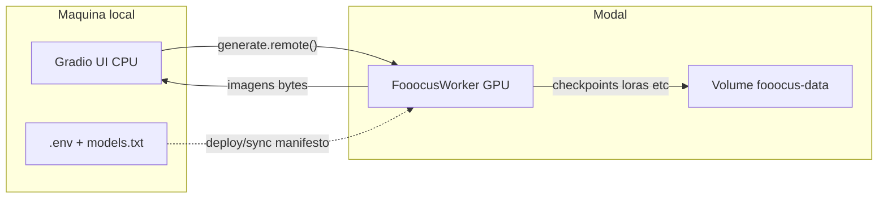

# Fooocus local + worker Modal (FinOps)

## Arquitetura

- **UI local**: Gradio com controles Fooocus. Sem GPU local. Sem custo de GPU na workstation.
- **Worker Modal**: `@app.cls` com GPU; `generate(...)` sob demanda; `.remote()` espera cold start, processa e devolve.
- **GPU fallback**: `gpu=["L4", "A10"]` (24GB). Lista via `MODAL_GPUS`.

## Ciclo de vida FinOps

1. **Gerar** → sobe worker se idle (cold start) → processa → devolve bytes à UI.
2. **Idle** → após `SCALEDOWN_WINDOW` (default 60s) → scale to zero → custo GPU = 0.
3. Hard rules: `min_containers=0`, `buffer_containers=0`, sem endpoint GPU always-on.
4. Custo residual idle: storage do Volume (modelos). Com `ZERO_TELEMETRY=true`, mídia de geração não fica no Volume.

## ZERO_TELEMETRY

Substitui a ideia de “não persistir I/O”:

- `ZERO_TELEMETRY=true` (default): inputs/outputs em paths efêmeros; retorno por bytes; sem retenção de mídia no Volume.
- `ZERO_TELEMETRY=false`: permite armazenar inputs/outputs no Volume.

Modelos **sempre** no Volume.

## Manifesto `models.txt`

- Não commitável (gitignore).
- Commitar apenas `models.txt.example`.
- Formato: `type<TAB>filename<TAB>url`.

## Estrutura alvo

Ver `docs/architecture/DIRECTORY.md` e fase 0 já criada sob governança em `.cursor/` + `docs/`.

## Implementação runtime

Adiada até solicitação explícita após o scaffold estrutural. Próximos módulos: `src/*`, `modal_app/app.py`, `local/ui.py`.

## Decisões

| Tema | Escolha |
|------|---------|
| Interface | Gradio local; Modal só GPU |
| Fooocus no Modal | Headless |
| GPU | L4 → A10 |
| I/O mídia | `ZERO_TELEMETRY=true` default |
| Push | Somente sob ordem explícita |
| Autor do projeto | Fabio "Drago" Monreal / fabio.monreal@outlook.com / LinkedIn |
| Repo | https://github.com/DragoHG/fooocus-modal |
| Autoria git | DragoHG / fabio.monreal@outlook.com |
