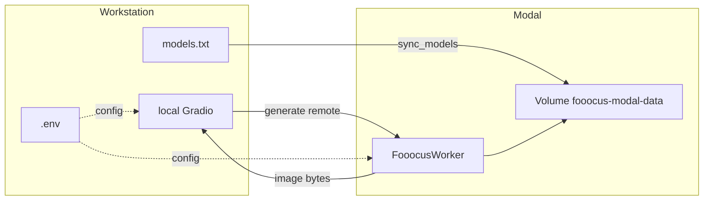

# Architecture overview

**fooocus-modal** separates a local Gradio UI from a Modal serverless GPU worker for Fooocus, with FinOps as the default operating mode.

**Author:** Fabio "Drago" Monreal — [LinkedIn](https://www.linkedin.com/in/fabiomonreal/) · [Website](https://fabio-monreal.vercel.app/en) · fabio.monreal@outlook.com

## Goals

- On-demand GPU: cost accrues only while a container runs
- Lean Modal backend (Fooocus `async_worker` only — no Gradio server in the cloud)
- Fast cold start via memory snapshots; checkpoints load lazily from the Volume
- Durable models on a Modal Volume; optional media retention
- Maintainer-controlled model set via local `models.txt` (not committed)
- Local UI exposes Fooocus image tools (vary/upscale, FaceSwap/IP, inpaint/outpaint, enhance)

## Context diagram

## Runtime lifecycle

1. User clicks **Generate** in the local UI.
2. Client invokes the deployed Modal class method (cold start if idle).
3. Worker loads checkpoints/LoRAs from the Volume, runs Fooocus headless, returns bytes.
4. After `SCALEDOWN_WINDOW` with no work, containers scale to zero — GPU billing stops.
5. Model storage on the Volume remains; with `ZERO_TELEMETRY=true`, generation media is not kept on the Volume.

## Components (planned)

| Component | Responsibility |
|-----------|----------------|
| `local/ui.py` | Gradio controls; Modal client; local preview/save |
| `modal_app/app.py` | Image build, Volume mount, worker class, `sync_models` |
| `src/manifest.py` | Parse/download model manifest into Volume folders |
| `src/paths.py` | Volume layout + `ZERO_TELEMETRY` path selection |
| `src/generate_params.py` | Shared request/response schema |
| `config/` | Fooocus path configuration templates |

## Configuration

See `.env.example`. Notable keys:

- `MODAL_GPUS` — ordered fallback list (default `L4,A10`)
- `SCALEDOWN_WINDOW` — idle seconds before scale-down (default `60`)
- `ZERO_TELEMETRY` — when `true`, do not persist inputs/outputs on the Volume
- `VOLUME_NAME` / `MODAL_APP_NAME` — Modal resource names (`fooocus-modal-data` / `fooocus-modal`)

## Non-goals (phase 0)

- Always-on Gradio hosted on GPU
- Baking multi-GB weights into the container image
- Multi-tenant auth/billing portals
