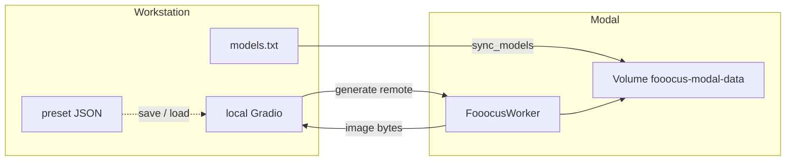

# Architecture overview

**fooocus-modal** pairs a local studio UI with a Modal GPU worker for Fooocus. You work on your machine; heavy compute runs only when you generate.

**Author:** Fabio "Drago" Monreal - [LinkedIn](https://www.linkedin.com/in/fabiomonreal/) · [Website](https://fabio-monreal.vercel.app/en) · fabio.monreal@outlook.com

## Goals

- Pay for GPU only while a job runs
- Keep the cloud worker lean (Fooocus worker only; no Gradio in the cloud)
- Faster cold starts via memory snapshots; checkpoints load from the Volume when needed
- Durable models on a Volume; optional ephemeral generation media
- Full Fooocus-style image tools locally, including presets you can save and reload

## Context diagram

## Runtime lifecycle

1. You click **Generate** in the local UI (or load a preset JSON first).
2. The client calls the deployed Modal worker (cold start if it was idle).
3. The worker reads models from the Volume, runs Fooocus headless, returns image bytes.
4. After `SCALEDOWN_WINDOW` with no work, containers scale to zero.
5. With `ZERO_TELEMETRY=true`, generation media is not kept on the Volume.

## Components

| Component | Responsibility |
|-----------|----------------|
| `local/ui.py` | Studio UI, presets, Modal client |
| `local/presets.py` | Save / load JSON settings |
| `modal_app/app.py` | Image build, Volume, worker, sync |
| `src/manifest.py` | Model manifest parse / download |
| `src/generate_params.py` | Shared generation schema |
| `src/fooocus_task.py` | Fooocus AsyncTask wiring |

## Configuration

See `.env.example` for `MODAL_GPUS`, `SCALEDOWN_WINDOW`, `ZERO_TELEMETRY`, and snapshot flags.

## Non-goals

- Always-on Gradio hosted on GPU
- Baking multi-GB weights into the container image
- Multi-tenant billing portals
